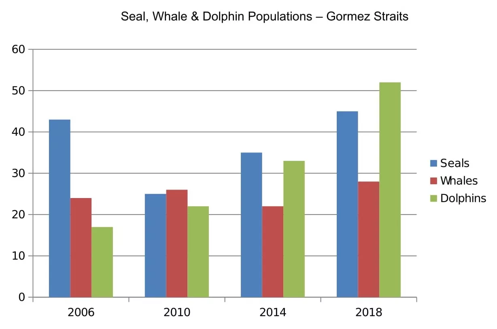
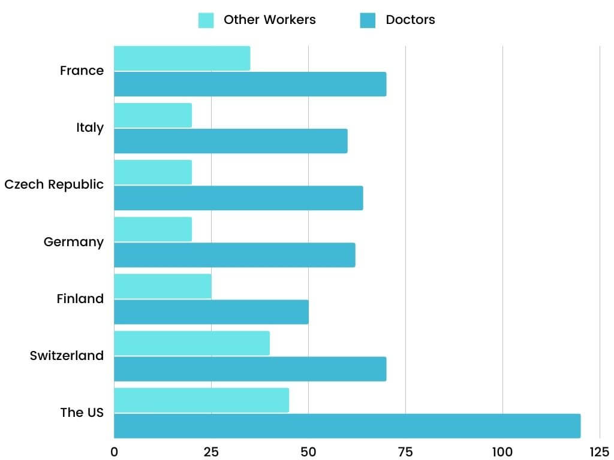

# Task 1: Bar Chart

Bar charts come in two kinds, and the language changes with them:

| Kind | Example | Language |
|---|---|---|
| **Dynamic**: bars for several years | *seals, whales and dolphins 2006–2018* | Trend language, as for a line graph: *rose significantly, saw a decline, steady upward trend* |
| **Static**: one point in time | *annual pay for doctors and other workers in seven countries in 2004* | Comparison and ranking: *topped the list, led with a substantial advantage, the lowest, $10,000 less than* |

## Structure

| Paragraph | Content |
|---|---|
| **Introduction** | *The bar chart illustrates* + what + where + when (*over a twelve-year period from 2006 to 2018* / *in 2004*). |
| **Overview** | *Overall,* + the main trend or main comparison + the highest category (and a change in ranking, if any). No numbers. |
| **Body 1** | Dynamic: the categories with steadier or mixed changes. Static: the first group (e.g. doctors). |
| **Body 2** | Dynamic: the category with the most dramatic change. Static: the second group (e.g. other workers). |

## Sentence frames (from the models)

- *In 2006, the seal population **stood at approximately** 27, **before rising significantly to around** 40 by 2010.*
- *However, this figure **saw a decline to about** 35 in 2014 **before climbing again to nearly** 50 by 2018.*
- *The whale population **exhibited a steady upward trend, starting at** 15 in 2006 **and reaching** 30 by 2018*
- *Starting at a modest 10 in 2006, the number of dolphins rose to… This growth continued dramatically, **culminating in** 55…*
- *Notably, the dolphin population **surpassed** both seals and whales by 2018*
- *…salaries **exhibited a wide range** across the seven countries, **from approximately** $50,000 **to** $120,000.*
- *The United States **led with a substantial advantage**, paying doctors an average of…*
- *…significantly more than **the joint second-place holders**, France and Switzerland, at around $70,000.*
- *Finland **recorded the lowest** income for doctors at $50,000, **which was $10,000 less than** Italy.*
- *Regarding other workers, the United States also **held the top spot** with…*
- *…making roughly $30,000 and $25,000 **respectively**.*
- *Notably, **the remaining three countries** paid their workers roughly $20,000 annually.*

---

## Model answer 1: Dynamic bar chart

**Task:** *The bar chart below shows numbers of seals, whales and dolphins recorded in the Gormez Straits from 2006 to 2018. Summarise the information by selecting and reporting the main features, and make comparisons where relevant. Write at least 150 words.*

> The bar chart illustrates the populations of seals, whales, and dolphins documented in the Strait of Gormez over a twelve-year period from 2006 to 2018.
>
> Overall, all three marine species experienced population growth over the period, with dolphins witnessing the most dramatic increase. In addition, as a result of a sharp rise, the number of dolphins surpassed that of seals to become the highest one in the final year.
>
> In 2006, the seal population stood at approximately 27, before rising significantly to around 40 by 2010. However, this figure saw a decline to about 35 in 2014 before climbing again to nearly 50 by 2018. The whale population exhibited a steady upward trend, starting at 15 in 2006 and reaching 30 by 2018, after rising moderately to roughly 20 in 2010 and 25 in 2014.
>
> In contrast to seals and whales, the dolphin population experienced substantial growth throughout the period. Starting at a modest 10 in 2006, the number of dolphins rose to around 15 in 2010. This growth continued dramatically, culminating in 55 dolphins recorded in 2018. Notably, the dolphin population surpassed both seals and whales by 2018, highlighting a significant shift in marine life in the Strait of Gormez.

**Why it works**

- The overview gives the general trend (all three grew), the biggest change (dolphins) and the **change of ranking** (dolphins overtook seals) without numbers.
- Body 1 groups seals and whales, the less dramatic changes. Body 2 is about the dolphins only, the most striking feature.

## Model answer 2: Static bar chart (one year, two groups)

**Task:** *The chart below shows the annual pay (thousands of US dollars) for doctors and other workers in seven countries in 2004. Summarise the information by selecting and reporting the main features, and make comparisons where relevant. Write at least 150 words.*

> The bar chart illustrates how the occupational earnings for doctors and other workers varied across seven nations in 2004.
>
> Overall, physicians consistently commanded higher salaries than other professionals in all countries surveyed. The United States topped the list for both doctors and other workers in terms of annual income, while income in Italy, the Czech Republic, Germany and Finland was relatively similar and low for both categories.
>
> Doctors' annual salaries exhibited a wide range across the seven countries, from approximately $50,000 to $120,000. The United States led with a substantial advantage, paying doctors an average of $120,000 per year, significantly more than the joint second-place holders, France and Switzerland, at around $70,000. In contrast, Finland recorded the lowest income for doctors at $50,000, which was $10,000 less than Italy.
>
> Regarding other workers, the United States also held the top spot with an average annual income of just over $40,000. Meanwhile, other professionals in France and Finland earned slightly less, making roughly $30,000 and $25,000 respectively. Notably, the remaining three countries paid their workers roughly $20,000 annually.

**Why it works**

- No trend verbs, because it is one year. The language is about **ranking and comparison**: *topped the list, led, joint second-place, the lowest, $10,000 less than*.
- The body paragraphs are split by **group** (doctors, then other workers), and each one goes from the highest to the lowest.
- The overview gives the main comparison (doctors always earned more) and the extremes (the US is highest, the others are similar and low).

> **Watch the units:** the axis says "thousands of US dollars", so 120 on the chart = **$120,000**.
