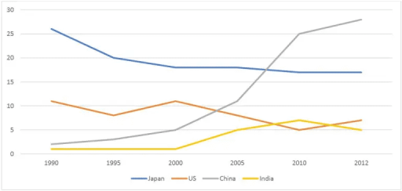
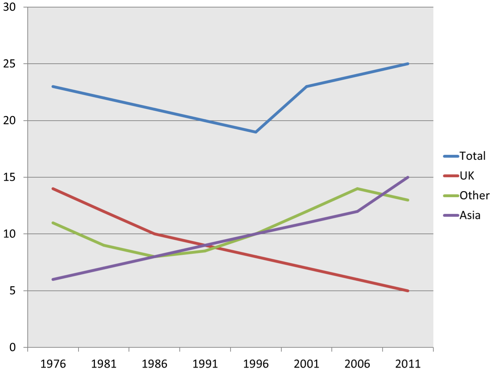
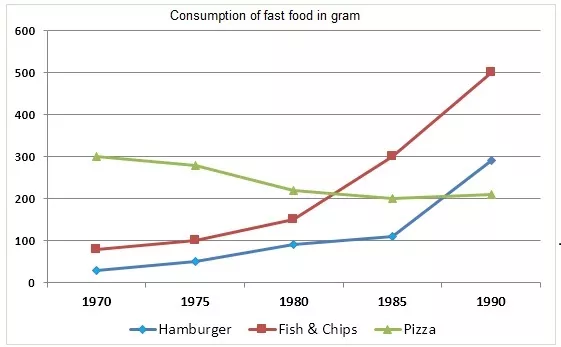

# Task 1: Line Graph

A line graph shows how one or more values **change over time**. Everything is about **trends**: rises, falls, fluctuations, peaks and points where one line overtakes another.

## Structure

| Paragraph | Content |
|---|---|
| **Introduction** (1 sentence) | Paraphrase: *The line graph illustrates / presents data on* + what + where + **over the period from … to …**. Name the categories with *namely …* if there are only a few. |
| **Overview** (1–2 sentences) | *Overall,* + the general trend of each group (up/down) with **while / whereas**, plus the biggest change or a **change of leader** (*China surpassed it and ranked first*). **No numbers.** |
| **Body 1** | The lines that **started highest / fell**: start value, changes, end value. |
| **Body 2** | The lines that **rose / started lowest**: start value, changes, end value, crossings. |

How to choose the groups: put lines with **similar trends** together (e.g. falling lines in Body 1, rising lines in Body 2), or the highest lines first.

## Sentence frames (from the models)

| Purpose | Frame |
|---|---|
| Starting point | *X were the highest at the beginning, standing at approximately … in 1990.* / *In 1976, X was the largest source of …, accounting for about 14%.* / *X began at a very low level of around … in 1990* |
| Fall | *However, this figure decreased consistently over the period, reaching around … in 2012.* / *X fell consistently over the following decades, dropping to 10% in 1986 and then to just 5% by 2011* |
| Fluctuation | *Meanwhile, X fluctuated. They started at about 11 billion, fell to 8 billion in 1995, then recovered to roughly the same level in 2000 before declining slightly again towards the end of the period.* |
| Rise | *… but rose sharply throughout the period. By 2012, they had surged to approximately 27 billion, overtaking … to become …* / *X rose steadily from 6% in 1976 to around 10% in 1996, before climbing more sharply to 15% in 2011* |
| Peak | *…reaching a peak of around 14% in 2006 before ending slightly lower at about 13% in 2011.* |
| Range | *Total numbers remained between 19 and 25 million throughout the period with a low point in 1996 and a peak in 2011.* |
| Ranking at the end | *…making it the smallest contributor at the end of the period.* / *…becoming the second dominant source.* |
| Linking | *Meanwhile, · By comparison, · Similarly, · By contrast, · However,* |

Trend vocabulary, prepositions and tenses: see [writing-task1-language.md](writing-task1-language.md).

---

## Model answer 1: Australian exports to four countries

**Task:** *The line graph shows the percentages of Australian exports to four countries. Summarize the information by selecting and reporting the main features and make comparisons where relevant.*

> The line graph illustrates the proportion of Australian exports to four distinct countries, namely Japan, the United States, China, and India, over the period from 1990 to 2012.
>
> Overall, an upward trend was seen in the percentage of Australian goods exported to India and China, while the US and Japan witnessed an opposite trend over the period shown. In addition, at the beginning, Japan was the main importer of Australian goods, whereas in the last year China surpassed it and ranked first.
>
> Exports to Japan were the highest at the beginning, standing at approximately 26 billion in 1990. However, this figure decreased consistently over the period, reaching around 17 billion in 2012. Meanwhile, exports to the US fluctuated. They started at about 11 billion, fell to 8 billion in 1995, then recovered to roughly the same level in 2000 before declining slightly again towards the end of the period.
>
> By comparison, exports to China began at a very low level of around 1 billion in 1990 but rose sharply throughout the period. By 2012, they had surged to approximately 27 billion, overtaking Japan and the US to become Australia's largest export market. Similarly, exports to India increased steadily from about 2 billion to around 7 billion in 2010, before experiencing a minor decline in the final years.

**Why it works**

- *Overview:* two sentences. The first gives the trends (*an upward trend… while… an opposite trend*) and the second the change of leader (*Japan was the main importer… whereas in the last year China surpassed it*). There are no numbers.
- *Body 1:* Japan (highest at the start, falling) and the US (fluctuating). These are the lines that did *not* grow.
- *Body 2:* China (from the lowest to the highest, overtaking the others) and India (*Similarly…* a steady rise).
- Uses the **past perfect with "by"**: *By 2012, they had surged to approximately 27 billion.*

## Model answer 2: Residents of Australia by region of origin

**Task:** *The line graph shows the proportion of residents living in Australia in millions from different regions between 1976 and 2011.*

> The line graph presents data on the percentage of people residing in Australia who came from different parts of the world over the period from 1976 to 2011.
>
> Overall, while the proportion of immigrants from the UK declined steadily throughout the period, the figures for Asia and other regions generally increased. Despite some fluctuations, the total percentage ended slightly higher than its initial level.
>
> In 1976, the UK was the largest source of immigrants, accounting for about 14%. However, the proportion from the UK fell consistently over the following decades, dropping to 10% in 1986 and then to just 5% by 2011, making it the smallest contributor at the end of the period. By contrast, immigration from Asia rose steadily from 6% in 1976 to around 10% in 1996, before climbing more sharply to 15% in 2011, becoming the second dominant source.
>
> The figure for immigrants from other regions experienced a slight decline at the beginning of the period, falling from 11% in 1976, to approximately 8% in the mid-1980s. However, this trend increased gradually over the following years, reaching a peak of around 14% in 2006 before ending slightly lower at about 13% in 2011. Total numbers remained between 19 and 25 million throughout the period with a low point in 1996 and a peak in 2011.

**Why it works**

- The overview contrasts the UK (*declined steadily*) with Asia and other regions (*generally increased*) using **while**, and mentions the total.
- Body 1 compares the UK and Asia, the two lines that **cross**. Body 2 covers "other regions" and the total.
- Approximations: *about 14%, around 10%, approximately 8%, around 14%*.

---

## Practice task (from "Types of graphs")

*The line graph below shows the consumption of 3 different types of fast food in Britain from 1970 to 1990. Summarise the information by selecting and reporting the main features, and make comparisons where relevant. Write at least 150 words.*

Plan hint: Overview: pizza was the most popular at the start but declined, while fish & chips and hamburgers rose, and fish & chips became the most popular by 1990. Body 1: pizza. Body 2: fish & chips and hamburgers (both rising, and the point where they cross pizza).

Other line graphs practised in class: *money spent on books in Germany, France, Italy and Austria (1995–2005)*, *students from the UK, the USA and Australia studying abroad (2002–2008)*, and *urban population in four Asian countries 1970–2020 with predictions for 2030 and 2040*. For the last one, use the [prediction structures](writing-task1-language.md#8-prediction-structures-future-data).
