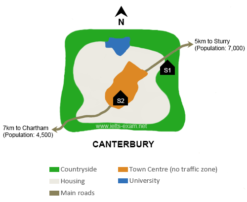
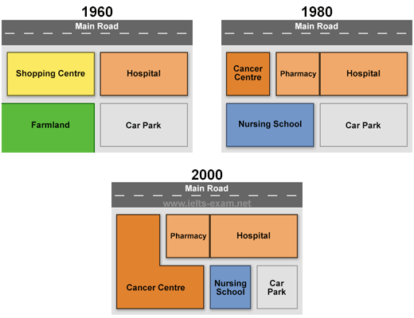
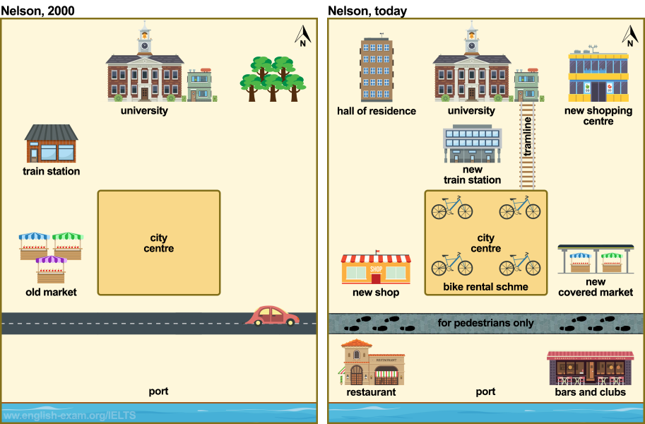
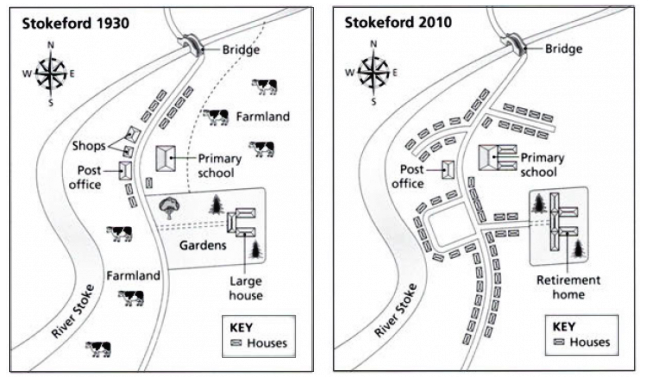

# Task 1: Map

Map tasks show either **changes to a place over time** (*the village of Stokeford in 1930 and 2010*) or **two possible sites / a plan** (*two possible sites for a new school*). There are no numbers to report, so describe **locations** and **changes**, mostly in the **passive voice**.

## Structure (teacher's handout: "The Structure of MAP")

| Paragraph | Content |
|---|---|
| **Paragraph 1: Introduction** | Paraphrase: *The provided map(s) illustrate(s) the structural changes and developments that occurred at / in … between … and …* |
| **Paragraph 2: Overview** | The most significant change(s) or the key difference, **without specific data, years or numbers**. |
| **Paragraph 3: 1st main feature** | One area of the map (e.g. *the northern sector*) or one time period (*In 1960… By 1980…*) or one site (*S1*). |
| **Paragraph 4: 2nd main feature** | The other area, period or site. |

## The overview for maps

*"An effective overview sentence for a map essay must summarize the most significant changes or trends without including specific data, years, or numbers. It typically highlights whether an area became more **urbanized, commercialized, accessible, or industrialized**."*

### Ready-made overview sentences (teacher's handout)

**Urbanization and residential development**: when a rural area, village or green space becomes a town, a housing estate or a city extension.
- *Overall, the village transformed from a primarily rural settlement into a highly developed, modern residential town.*
- *Overall, the area experienced significant urbanization, characterized by a substantial increase in housing infrastructure at the expense of agricultural land.*
- *Overall, the landscape saw a dramatic shift from open countryside to an extensive residential estate with modernized amenities.*

**Commercialization and leisure expansion**: tourist facilities, shopping malls, restaurants, hotels and recreational zones added.
- *Overall, the resort underwent a major redevelopment, shifting its focus entirely toward tourist accommodations and leisure activities.*
- *Overall, the town center became heavily commercialized, with a variety of new retail spaces and recreational facilities replacing the older, traditional structures.*
- *Overall, the coastal area was significantly modernized to maximize its utility as a holiday destination.*

**Industrialization and purpose changes**: factories built, or an old industrial zone converted.
- *Overall, the northern district was completely transformed from a quiet residential zone into a prominent industrial hub.*
- *Overall, the town underwent a total transformation as its central industrial sector was entirely cleared to make way for a pedestrianized commercial zone.*
- *Overall, the layout shows a clear transition from heavy industrial operations to consumer-focused retail and public parks.*

**Infrastructure and accessibility improvements**: new transport networks, roads, bridges, roundabouts and train lines.
- *Overall, the region's transport infrastructure was vastly improved, making the eastern side of the river much more accessible.*
- *Overall the development focused heavily on improving connectivity, with the introduction of several new access roads and parking facilities.*
- *Overall, while the core buildings remained unchanged, the surrounding layout was modernized with a highly interconnected road network.*

**Internal building layout alterations**: floor plans of libraries, museums, schools and so on.
- *Overall, the interior of the building was restructured to create an open-plan layout with a stronger focus on technology and public spaces.*
- *Overall, the internal redesign maximized student capacity by expanding the main hall and shrinking the administrative offices.*
- *Overall, the layout was remodeled to optimize visitor flow, shifting the main entrance and adding multiple amenities.*

---

## Map vocabulary (teacher's handout)

### Direction and location

- **Cardinal directions:** North / South / East / West · Northwest / Northeast / Southwest / Southeast
- **Prepositions of place:** In the north/south/east/west of… · To the north/south/east/west of… · In the centre / At the centre · In the middle · On the left / right side · Next to / Beside / Adjacent to · Opposite · Near / Close to · Between · At the corner of · Along · Across from

> *in the north of* = inside that part of the area · *to the north of* = outside it, in that direction.

### Changes over time (passive)

| | |
|---|---|
| Was developed into · Was transformed into · Was converted into · Was turned into | Was replaced by |
| Was removed / Was demolished · Was flattened | Was added / Was introduced |
| Was constructed / Was built | Was relocated / Was moved |
| Was expanded / Was enlarged · Was extended | Was reduced / Was cut down |
| Was upgraded · Was modernised | Was made pedestrian-only |
| Changed from … to … | Witnessed dramatic changes · Experienced significant development |

### Static maps (no time change)

Is situated · Is located · Lies · Stands · Contains · Includes · Features · Comprises · Consists of · Surrounds · Faces · Overlooks

### Infrastructure and land use

Residential area / housing area · Industrial area / commercial area · Farmland / Agricultural land · Green space / Park / Playground · Forest / Wooded area · River / Stream / Canal · Lake / Pond · Hill / Mountain · Road / Street / Path · Roundabout / Intersection / Junction · Car park / Parking lot · School / Hospital / University · Shops / Shopping centre / Supermarket · Train station / Bus stop / Airport · Hotel / Restaurant / Café · Sports centre / Gym / Swimming pool · Bridge / Tunnel · Marina / Port / Dock

### Verbs for map tasks

Expand · Build · Construct · Renovate · Demolish · Remove · Replace · Convert · Develop · Extend · Transform · Modernise · Introduce · Install · Enlarge · Relocate · Merge

### Adjectives and adverbs for describing changes

Dramatic / Substantial / Significant · Moderate / Noticeable / Considerable · Slight / Minor / Minimal · Gradual / Steady · Rapid / Sudden · Completely / Entirely / Thoroughly · Partially / Slightly / Marginally

### Extra location terms and phrases (teacher's chat note on map questions)

*Junction · Leads off · Dead end · Right-hand side / left-hand side · A little beyond · Before you get to · Just past · Runs alongside · Enter via · Adjoining · Behind · Beyond · Corner*

- *The stadium is centrally located on the college campus.*
- *The restroom is positioned between the gym and reception.*
- *The seating area is adjacent to the gym.*
- *There is an open area just past the stadium.*
- *The park is just beyond the first row of houses to the east.*
- *The garden is located just southwest of the high school.*
- *The theatre is a bit west of the primary school.*
- *A new school is planned to be built across the road from the hospital at point F.*
- *The library is on the same side of the road as the school.*

**Tenses:** past maps use the **past simple passive** (*was replaced by*). For "then and now" maps use the **present perfect passive** (*has been cleared, has been constructed*), as in the Nelson model. For changes before a past point use *had + V3* (*By 1980, notable changes had occurred*). For planned changes use [prediction structures](writing-task1-language.md#8-prediction-structures-future-data) (*is planned to be built*).

---

## Model answer 1: Two possible sites (static map)

**Task:** *The map below is of the town of Canterbury. A new school (S) is planned for the area. The map shows two possible sites for the school. Write at least 150 words.*

> The provided map illustrates two proposed locations (S1 and S2) for a new school within the city of Canterbury and its surrounding areas.
>
> Overall, S1 is situated in a rural environment on the outskirts of the city, whereas S2 is centrally located within an urban zone. Furthermore, S1 offers greater proximity to neighboring towns and higher education facilities, while S2 serves the immediate residential core.
>
> Looking at the first location, S1 is positioned in the countryside northeast of the city center. It sits directly adjacent to a main road that leads to Sturry, a town located 5 kilometers away with a population of 7,000. Additionally, this site is situated in just east of a local university and bordered by residential housing to its west.
>
> In contrast, S2 is located directly within the town center, which is designated as a pedestrian-only, no-traffic zone. This central site is entirely enclosed by housing, making it highly accessible to local residents. A main road runs from the south-west up through the town center, linking S2 to the town of Chartham, which lies 7 kilometers away and has a population of 4,500.

*(The handout has a small slip: "situated in just east of". Read it as "situated just east of".)*

## Model answer 2: Changes over three years

**Task:** *The maps below show the changes that have taken place at Queen Mary Hospital since its construction in 1960.*

> The provided maps illustrate the structural changes and developments that occurred at Queen Mary Hospital across three distinct years: 1960, 1980, and 2000.
>
> Overall, the entire area underwent significant modernization over the 40-year period. The hospital itself expanded its medical infrastructure by incorporating specialized centers, which led to a substantial reduction in both green spaces and parking facilities.
>
> In 1960, the hospital was located in the northeast section of the site, adjacent to a main road and a shopping center to its west. Behind the hospital lay a large car park, while the area south of the shopping center was occupied by farmland. By 1980, notable changes had occurred: the shopping center was replaced by a newly constructed Cancer Centre, and a pharmacy was added directly next to the original hospital building. Additionally, the farmland was entirely cleared to make way for a new Nursing School, while the car park remained unaltered.
>
> By the year 2000, further redevelopments took place. The Cancer Centre underwent a massive expansion, tripling in size to wrap around the pharmacy and connect directly with the Nursing School to the south. To accommodate this expansion, the Nursing School was relocated eastward, which ultimately halved the size of the original car park.

**Why it works:** the body is organised **by time** (1960 to 1980 in Body 1, 2000 in Body 2). It uses *was replaced by, was added, was entirely cleared to make way for, was relocated, tripling in size, halved the size*.

## Model answer 3: Then and now

**Task:** *The maps below show changes in the city of Nelson in recent times. Summarise the information by selecting and reporting the main features, and make comparisons where relevant. Write at least 150 words.*

> The maps illustrate the structural developments that have taken place in the city of Nelson from 2000 to the present day.
>
> Overall, the city has undergone significant modernization, transforming from a car-accessible layout into a denser, pedestrian- and student-friendly urban center with expanded commercial, leisure, and accommodation facilities.
>
> In the northern sector, the university campus remains unchanged; however, the adjacent eastern woodland has been cleared to make way for a new shopping center. Conversely, a multi-story hall of residence has been constructed to the west of the campus. The original train station was relocated slightly south and is now uniquely linked to the city center via a new tramline.
>
> Major transformations have also occurred in the commercial and southern zones. The old western market has been replaced by a new shop, while a covered market has been built to the east. Meanwhile, the central square has been completely converted into a bike rental scheme. Finally, the southern main road has become a pedestrian-only zone, and the empty port has been developed with a new restaurant, bars, and clubs.

**Why it works:** the body is organised **by area** (northern sector, then commercial and southern zones), and it uses the **present perfect passive** because the second map is "today".

---

## Practice task (from "Types of graphs")

*The maps below show the village of Stokeford in 1930 and 2010.*

Plan hint: Overview (urbanization): *the village transformed from a primarily rural settlement into a more developed residential area, at the expense of farmland*. Body 1: the main road area (the shops became houses, and the post office and bridge remained). Body 2: the school was extended, the large house and gardens became a retirement home, and new housing replaced the farmland.
