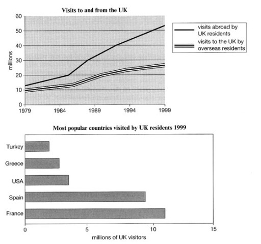
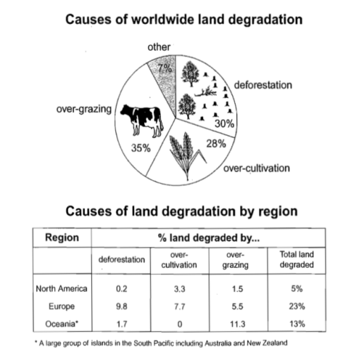
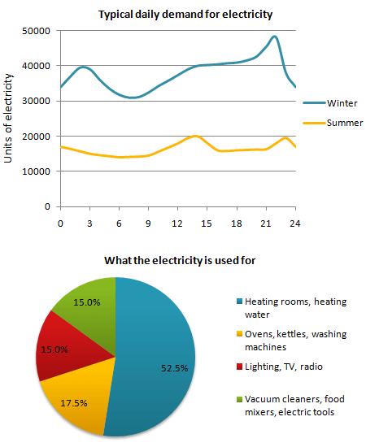

# Task 1: Multiple / Mixed Graphs

Sometimes you get **two different visuals** on a related topic: a line graph and a bar chart, a pie chart and a table, and so on. You still have only 20 minutes and about 170–190 words, so **select carefully**.

## Structure (teacher's board notes)

> **INTRODUCTION**
> - paraphrase the tasks
> - While/and
>
> **OVERVIEW**
> - Overall,
> - No number/percentage/year
> - Increase/decrease
> - Max/min
>
> **DETAIL PART**
> - the first graph
> - The second graph

| Paragraph | Content |
|---|---|
| **Introduction** | Paraphrase **both** tasks in one sentence joined with **while** or **and**: *The line graph shows …, **while** the bar chart shows …* / *The pie chart indicates …, **and** the table illustrates …* |
| **Overview** | *Overall,* + the key feature of graph 1 + the key feature of graph 2 (increase/decrease, max/min). No numbers. |
| **Body 1** | **The first graph** only. |
| **Body 2** | **The second graph** only. |

> Don't mix the two charts in one paragraph. One paragraph per visual keeps it clear. Link them only if there is an obvious connection.

---

## Model answer 1: Line graph + bar chart

**Task:** *The line graph shows visits to and from the UK from 1979 to 1999, and the bar graph shows the most popular countries visited by UK residents in 1999.*

> The line graph shows the number of visits to and from the United Kingdom between 1979 and 1999, while the bar chart shows the five most popular holiday countries for UK residents in 1999.
>
> Overall, both the number of UK residents traveling abroad and foreign visitors coming to the UK increased over the 20-year period. However, UK residents traveling abroad always outnumbered foreign visitors. France and Spain were the most popular choices for UK tourists.
>
> In 1979, the number of UK residents traveling abroad was just over 10 million. This was slightly higher than the number of foreign visitors to the UK, which was around 10 million. Over the next twenty years, the number of UK travelers rose quickly to more than 50 million. At the same time, the number of foreign visitors grew steadily, reaching nearly 28 million by 1999.
>
> Looking at the destinations in 1999, France was the most visited country, with over 10 million UK tourists. Spain was the second most popular choice, with around 8 million visitors. In contrast, Turkey was the least popular destination, with only about 2 million visitors. Greece was the second least popular country, drawing nearly 4 million UK tourists.

**Why it works**

- The introduction joins the two charts with **while**.
- The overview covers graph 1 (both rose, and residents going abroad always outnumbered visitors) **and** graph 2 (France and Spain were the most popular).
- Body 1 is the line graph (start and end values). Body 2 is the bar chart (from the most to the least popular).

## Model answer 2: Pie chart + table

**Task:** *The pie chart below shows the main reasons why agricultural land becomes less productive. The table shows how these causes affected three regions of the world during the 1990s.*

> The pie chart indicates four primary causes of farmland becoming degraded in the world, and the table illustrates how they affected different regions in the 1990s.
>
> Overall, over-grazing, deforestation, and over-cultivation were the three major contributors to land degradation, with over-grazing being the most significant. Among the regions, Europe experienced the highest percentage of land degradation, whereas North America had the least.
>
> Over-grazing accounted for 35% of the land degradation globally, making it the leading cause. Deforestation followed closely at 30%, while over-cultivation represented 28%. A smaller proportion, 7%, was attributed to other causes.
>
> In terms of regional impact, Europe suffered the most severe degradation, with a total of 23% of its land affected. Deforestation was the biggest issue in Europe, impacting 9.8% of land. Over-cultivation was also significant at 7.7%, while over-grazing contributed to a lesser extent at 5.5%. Oceania, in contrast, was mostly affected by over-grazing, which accounted for 11.3% of land degradation, bringing its total degradation to 13%. North America had the lowest overall degradation, at 5%, with over-cultivation as the primary factor, at 3.3%, and much lower figures for deforestation and over-grazing, at 0.2% and 1.5%, respectively.

**Why it works**

- The overview gives the max of the pie (over-grazing is the leading cause) and the max/min of the table (Europe the most, North America the least).
- Body 1 covers the pie chart in four sentences, from the largest to the smallest. Body 2 covers the table region by region, with each region's **total** first and then its main cause.

---

## Practice task (from "Types of graphs")

*The graph below shows the demand for electricity in England during typical days in winter and summer. The pie chart shows how electricity is used in an average English home.*

Plan hint: Overview: demand was much higher in winter than in summer at all times of the day, and heating rooms and water used more than half of household electricity. Body 1: the line graph (the winter peak of almost 50,000 units at around 10 pm and the low of just over 30,000 at about 7–8 am, compared with summer, which stayed between roughly 14,000 and 20,000 units). Body 2: the pie chart (heating 52.5%, then ovens, kettles and washing machines 17.5%, and lighting/TV/radio and vacuum cleaners/tools 15% each).
