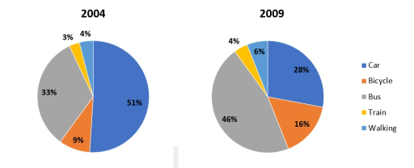
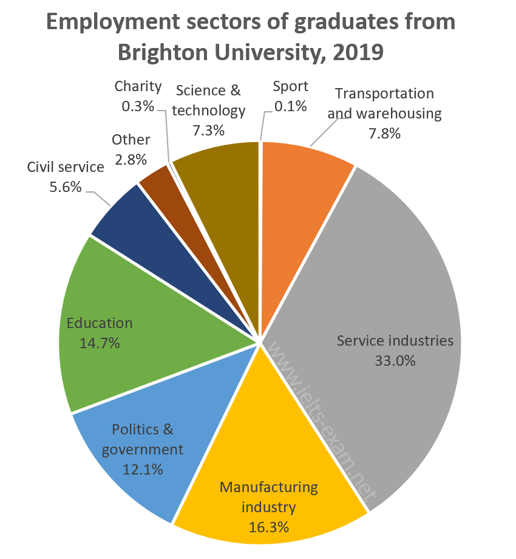

# Task 1: Pie Chart

Pie charts show **proportions of a whole** (100%). There are two common versions:

| Version | Example | What to describe |
|---|---|---|
| **Two or more pies, different years** | *methods of transport to a university, 2004 vs 2009* | **Changes** between the years (*decreased considerably to 28%*, *experienced a sharp increase*) and the change of the largest segment. |
| **One pie** (static) | *Brighton University graduates by employment sector, 2019* | **Ranking and comparison** of the segments (*held the largest share by a wide margin*, *nearly twice as much as*). |

## Structure

| Paragraph | Content |
|---|---|
| **Introduction** | *The pie chart(s) illustrate(s) the percentage / proportion of …* + who/what + when. |
| **Overview** | *Overall,* + the largest (and smallest) segment, plus the main changes if there are several years (*were overtaken by buses as the primary choice*). No numbers. |
| **Body 1** | The **largest** segments, with figures and comparisons. |
| **Body 2** | *Regarding the remaining categories / sectors, …* The smaller segments, ending with the smallest. |

## Proportion language (from the models)

| Verb | Example |
|---|---|
| **account for** | *Cars accounted for over half of all university commutes in 2004, at 51%.* |
| **constitute** | *…constituted exactly one-third of the total (33%).* |
| **comprise** | *…comprised 7.8% and 7.3% respectively.* |
| **hold the largest share** | *…service industries held the largest market share by a wide margin* |
| **be followed by** | *This was followed by the manufacturing industry at 16.3% and education at 14.7%.* |
| **attract** | *…charity (0.3%) and sport (0.1%) both attracted less than 1% of applicants* |
| **be utilized by** | *…train travel was the least popular option, utilized by a mere 3% of travelers* |
| **share / proportion / percentage / figure** | *the share of people traveling by bicycle saw a significant climb* |

Fractions: *over half, exactly one-third, nearly twice as much as, a mere 3%, less than 1%*. For the full list, see [writing-task1-language.md](writing-task1-language.md#5-approximation-and-percentages-in-words).

---

## Model answer 1: Two pie charts (change over time)

**Task:** *The charts show the main methods of transportation for people travelling to a university for work or study in 2004 and 2009.*

> The pie charts illustrate the percentage of students and staff utilizing different modes of transportation to travel to a university in 2004 and 2009.
>
> Overall, private cars were the most popular means of transport at the beginning of the period, while they were overtaken by buses as the primary choice in the final year. The percentage of people traveling by bus, train, walking and bicycle increased, whereas the figure for car decreased over the five-year period.
>
> Cars accounted for over half of all university commutes in 2004, at 51%. However, this figure decreased considerably to 28% in 2009. Although the proportion of commuters taking the bus stood lower than that of cars in 2004, at 33%, it experienced a sharp increase to reach 46% by 2009, making it the top transit method.
>
> Regarding the remaining categories, the share of people traveling by bicycle saw a significant climb, rising from 9% to 16% between 2004 and 2009. Walking to the campus accounted for just 4% of journeys in 2004 before experiencing a slight rise to 6% in 2009. Finally, train travel was the least popular option, utilized by a mere 3% of travelers in 2004, after which it grew marginally to 4% by the end of the period.

**Why it works**

- The overview has the **change of leader** (cars, then buses) and the general direction (every mode increased except cars).
- Body 1 covers the two biggest segments, which "swap places". Body 2 covers the three small segments, from the largest to the smallest.
- Each sentence gives **both years** (*rising from 9% to 16% between 2004 and 2009*).

## Model answer 2: One pie chart (static)

**Task:** *The chart below shows the proportions of graduates from Brighton University in 2019 entering different employment sectors.*

> The pie chart illustrates the proportion of Brighton University graduates who applied for various employment categories in 2019.
>
> Overall, service industries held the largest market share by a wide margin, whereas sports accounted for the smallest percentage of applicants in the same year.
>
> The proportion of graduates who opted for service industries constituted exactly one-third of the total (33%). This was followed by the manufacturing industry at 16.3% and education at 14.7%. Meanwhile, the percentage for politics and government accounted for 12.1%, which was nearly twice as much as that of the civil service (5.6%).
>
> Regarding the remaining sectors, the figures for transportation & warehousing and science & technology comprised 7.8% and 7.3% respectively. On the other hand, other fields accounted for 2.8%, while charity (0.3%) and sport (0.1%) both attracted less than 1% of applicants, making them the least popular sectors.

**Why it works**

- With nine segments, it is impossible to describe each one in detail, so the writer **ranks** them and **groups** the smallest ones.
- Comparisons: *exactly one-third*, *nearly twice as much as*, *respectively*, *less than 1%*.
