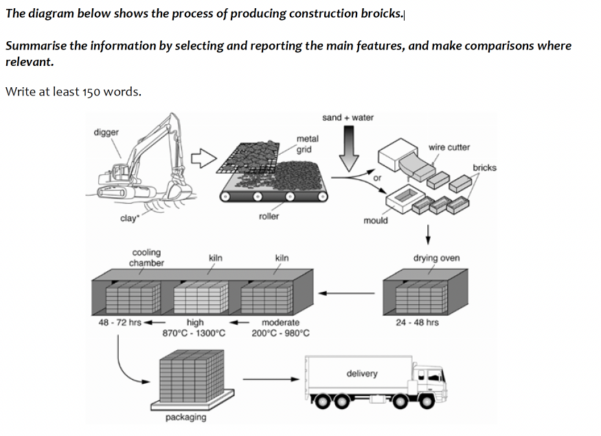
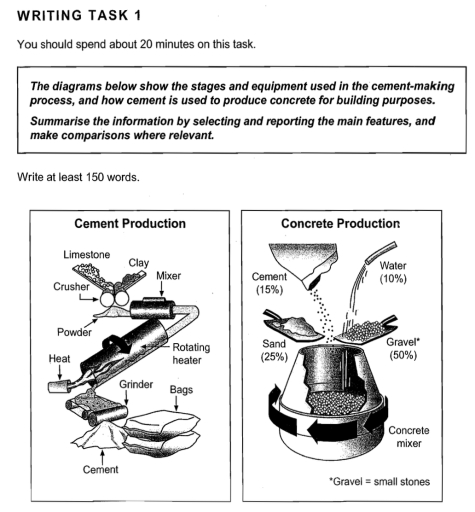
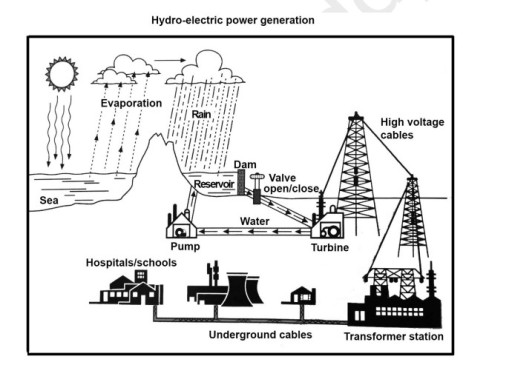
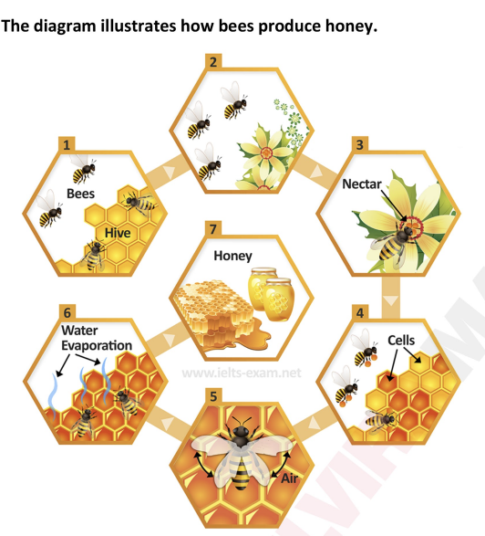

# Task 1: Process Diagram

A process diagram shows **stages in order**. It can be a **man-made** (manufacturing) process such as bricks, cement or hydro-electric power, or a **natural** one such as how bees make honey. There are no numbers to compare, so the language you need is **sequence linkers**, the **passive voice** and **process verbs**.

## Structure

| Paragraph | Content |
|---|---|
| **Introduction** | Paraphrase: *The diagram illustrates the step-by-step process of …* / *The process diagram illustrates the generation of …* |
| **Overview** | **Number of stages + first stage + last stage** (+ simple/complex): *"Overall there are (7) stages/steps in the process, beginning with ______ and culminating in ________."* |
| **Body 1** | The first half of the stages, in order. |
| **Body 2** | The second half of the stages, in order (or the second diagram if there are two). |

## Useful linking words for process diagrams (teacher's handout)

**To show sequence:** Initially · In the first stage · First · Next · Subsequently · Following this · In the final stage · Finally

**To connect stages:** before · after · once · when · as soon as · while · during
- *Once the juice has been filtered, it is heated.*
- *After being crushed, the canes are processed further.*
- *When the mixture reaches the required temperature, it is removed.*

**To combine information:** which · where · by which · in which · resulting in · leading to
- *The juice passes through a filter where impurities are removed.*
- *The liquid is heated, resulting in the formation of syrup.*
- *The process ends in a centrifuge, in which the crystals are separated.*

### Use "-ing" structures to increase complexity

*"One of the easiest ways to improve your grammar score is to use verb + ing clauses."*
- before being purified
- after leaving the factory
- following the extraction stage
- resulting in a thick syrup
- producing sugar crystals

### Less common linking words

- The process starts (with, when)
- In the first stage / initial stages…
- The first step is to…
- The process continues until (it forms / it reaches the desired consistency).
- It undergoes further processing to (remove any remaining impurities)
- Once this stage is complete, …
- After completion of this stage, …
- The next step is …
- Once / When / As soon as this has finished, …
- The process culminates / ends (in)

### Language related to processes

- The process involves (+ing verb)
- The process consists of (5 stages)
- This requires (specialist machinery / a device)
- This is done mostly by hand / mechanically / by machine.
- The procedure is (mostly) automated.
- This is achieved by a process of (steaming)
- Production is largely mechanised.
- This is a relatively simple process.
- This is a lengthy, complicated, time-consuming, energy-efficient, energy-intensive process.
- Ready for … packaging, consumption, sale, distribution
- The final product
- To manufacture the final product
- Which results in… / Resulting in…
- It is boiled until it (thickens)
- Ready to be consumed, used, sent, packaged
- **Overall there are (7) stages/steps in the process, beginning with ______ and culminating in ________.**

### Other useful vocabulary (passive verbs)

| Subject | … are |
|---|---|
| **(Plants)** | picked, harvested, cut down, gathered, collected, sorted · transported, taken, moved, sent to · placed/put into, fed through · washed, cleaned, purified · chopped, shredded, cut up, cut into small pieces · dried, crushed, ground · blended, squeezed · discarded, removed |
| **Liquids** | heated, boiled · filtered · concentrated/condensed · treated with (lime) · poured into |
| **Materials** | bleached, dyed · polished, smoothed, ironed, softened · soaked, washed, submerged · made into, transformed into · added · combined, mixed |
| **Products** | placed onto (a conveyor belt) · placed into (an oven, a kiln) · packed, bagged, labelled, delivered · transported, taken to, shipped · ready to be used |

> **Grammar:** man-made processes are described in the **present simple passive** (*clay is dug, the mixture is heated*). Natural processes often use the **active** voice (*bees leave the hive, water evaporates*).

---

## Model answer 1: Brick manufacturing (man-made, 9 stages)

**Task:** *The diagram illustrates the process that is used to manufacture bricks for the building industry.*

> The diagram illustrates the step-by-step process of brick production for the building industry.
>
> Overall, the production involves nine key stages, beginning with raw material extraction and culminating in delivery.
>
> The process starts when clay is dug from the ground using a mechanical digger. The clay then passes through a metal grid and roller, which break it into smaller pieces. After that, sand and water are added to the clay mixture. This mixture is shaped into bricks either by using moulds or by cutting it with a wire cutter.
>
> Subsequently, the bricks undergo two heating phases in a kiln. First, they are exposed to moderate temperatures ranging from 200°C to 980°C. Then, they are fired at high temperatures between 870°C and 1300°C to strengthen them. After heating, the bricks are transferred to a cooling chamber to stabilize their structure. Finally, the finished bricks are packaged and delivered to construction sites for use in brickwork.

**Why it works:** the overview gives the number of stages, the first stage and the last stage. Body 1 covers the shaping stages and Body 2 the heating and delivery stages. *Watch out:* the model leaves out the **drying oven (24–48 hrs)** stage between moulding and the kiln. In the exam, mention every stage, e.g. *"The bricks are then dried in a drying oven for 24–48 hours before being fired in a kiln."*

## Model answer 2: Cement and concrete (two diagrams)

**Task:** *The diagrams below show the stages and equipment used in the cement-making process, and how cement is used to produce concrete for building purposes.*

> The diagrams illustrate the processes involved in the production of cement and the subsequent use of cement in the creation of concrete for construction purposes.
>
> Overall, the process of cement-making is more complex than concrete production, involving more than six stages and specific equipment. Conversely, the concrete mixing process is comparatively straightforward, requiring a mixture of materials in defined proportions.
>
> Observing the cement manufacture in detail, the procedure starts with crushing limestone and clay in a crusher, turning them into small particles. Afterwards, the two previously ground substances are then combined using a mixing machine. Subsequently, the well-blended mixture is heated thoroughly in a rotating machine. Once that process is completed, it is ground before being transferred into packages.
>
> The concrete production only involves one primary phase, beginning with adding 50% of gravel, 25% of sand, 15% of cement, and 10% of water straight into the mixing machinery, where all components are blended together to form concrete.

*(157 words)* With two diagrams, write **one body paragraph per diagram** and compare their complexity in the overview.

## Model answer 3: Hydro-electric power

**Task:** *The diagram below shows the process of using water to generate electricity for human use.*

> The process diagram illustrates the generation of hydro-electric power and its subsequent supply to various buildings.
>
> Overall, hydroelectric power is generated using natural water cycles through a multi-stage procedure, beginning with the evaporation of sea water and ending with the final distribution of electricity to residential, public, and industrial properties.
>
> The process begins with the evaporation of sea water, which leads to rainfall collected in a reservoir that is blocked by a dam. The stored water then flows through pipes to a valve, which regularly opens and closes to control the water flow. After passing the valve, the water moves to a turbine. The force of the moving water drives the turbine, generating electricity that is transferred to high-voltage power lines. The water that has passed through the turbine is then pumped back into the reservoir, allowing the process to continue.
>
> In the next stage, the generated electricity is sent to a transformer station via electrical cables. From there, it is distributed to different buildings. Underground cables deliver electricity to homes, schools, and hospitals, while factories are also supplied with power.

## Model answer 4: How bees make honey (natural process)

**Task:** *The diagram illustrates how bees produce honey.*

> The process diagram gives data on the process showing how bees make honey.
>
> Overall, the procedure of making honey consists of 7 simple stages, which starts with making the hive to the extraction and culminates in the end product for human consumption.
>
> The process starts when bees as a group begin making the hive which is called a honey container. In the following stage, the bees leave the hive in order to find flowers to collect nectar which is sweet liquid produced from them. In the stage after that the nectar is taken back to the hive where the production starts.
>
> This is followed by filling the cells with the nectar before the bees use their wings to fan and cool down the nectar-filled hives. In the sixth stage, water from the cells containing nectar in the hives evaporates. The process ends when the nectar loses water and turns into honey.

*This model is short (about 150 words). For a natural cycle, active verbs are fine (bees leave, nectar evaporates).*

---

## Checklist

- [ ] The overview gives the **number of stages**, the **first** and the **last** stage.
- [ ] Every stage is mentioned, **in order**, and none is skipped.
- [ ] Sequence linkers are varied (not *then… then… then…*).
- [ ] The passive voice is used for man-made processes, and the object nouns from the diagram labels are included (*kiln, mould, wire cutter, turbine*).
- [ ] At least one *-ing* clause and one relative clause (*which / where / in which*).
