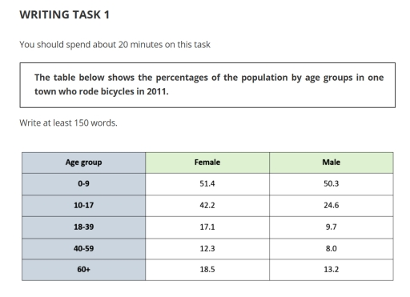
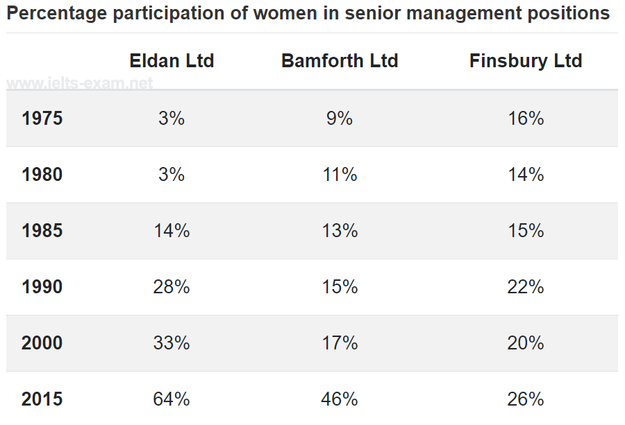
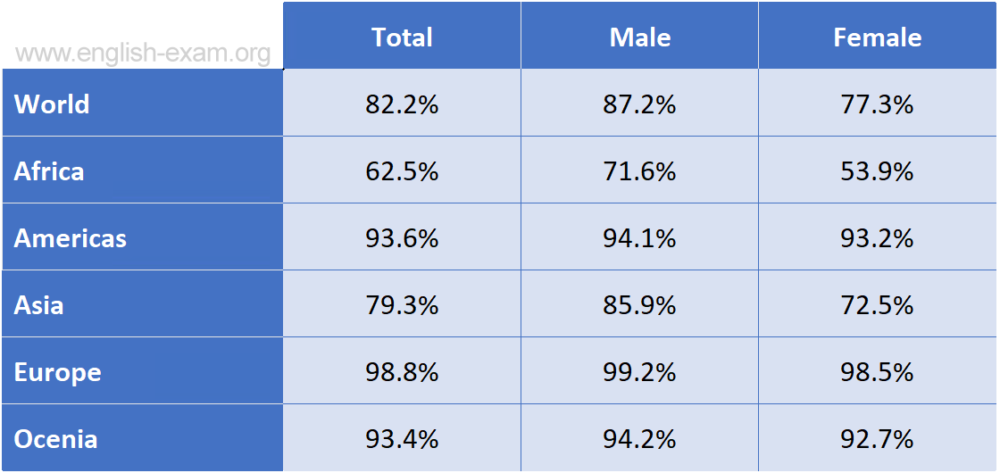

# Task 1: Table

A table gives you **many exact numbers**. The main skill is **selecting**: find the highest and lowest values, the biggest gaps and the overall pattern, and don't copy every cell.

## Structure

| Paragraph | Content |
|---|---|
| **Introduction** | *The table illustrates / shows the percentage(s) of …* + who + when (+ *classified by gender / by region*). |
| **Overview** | *Overall,* + the main pattern across rows (*younger individuals… were more likely to…*) + the main pattern across columns (*females generally cycled more than males*), or the highest/lowest category at the end. No numbers. |
| **Body 1** | The first group of rows/columns, with figures and direct comparisons. |
| **Body 2** | The remaining rows/columns (*When it comes to… / The percentage of … in …*). |

How to read a table quickly:
1. Find the **largest and smallest** numbers.
2. Compare **rows** (e.g. age groups) and **columns** (e.g. male vs female, company A vs B).
3. If there are years, look at the **direction** of each column (up/down/fluctuating) and any changes of ranking.

## Sentence frames (from the models)

- *In the youngest group, 50.3% of males rode bicycles, **compared with a slightly higher figure of** 51.4% for females.*
- *Among those aged 10-17, the proportion of female cyclists remained relatively high at 42.2%, **whereas the corresponding figure for** males was considerably lower, at 24.6%.*
- ***A similar pattern was observed among** 18–39-year-olds, with 17.1% of females cycling, compared with only 9.7% of males.*
- ***When it comes to** people aged 40-59, only 8% of males and 12.3% of females rode bicycles, **making this group the least active overall**.*
- ***In terms of** Eldan Ltd, **although it recorded the smallest figure in** 1975 and 1980, at just 3%, it grew continuously…*
- *…increased steadily **by two percentage points every five years**, rising from 9% to 17%, before climbing more sharply to 46% in 2015.*
- *…**making it the highest initial share relative to the three**.*
- *After this peak, it **dipped** again to 20% in 2000 and **rebounded** to 26% in 2015*

> Note **percentage points**: a change from 9% to 11% is a rise of **two percentage points**, not "2%".

---

## Model answer 1: Static table (one year, by age and gender)

**Task:** *The table below shows the percentages of the population by age groups in one town who rode bicycles in 2011.*

> The table illustrates the percentages of people in different age groups in a town who rode bicycles in 2011, classified by gender.
>
> Overall, younger individuals, regardless of gender, were more likely to ride bicycles, with the highest proportions seen in the 0–9 age group. Additionally, females generally cycled more than males across all age groups, with the most significant gender gap observed among teenagers.
>
> In the youngest group, 50.3% of males rode bicycles, compared with a slightly higher figure of 51.4% for females. Among those aged 10-17, the proportion of female cyclists remained relatively high at 42.2%, whereas the corresponding figure for males was considerably lower, at 24.6%. A similar pattern was observed among 18–39-year-olds, with 17.1% of females cycling, compared with only 9.7% of males.
>
> When it comes to people aged 40-59, only 8% of males and 12.3% of females rode bicycles, making this group the least active overall. By contrast, the figures were higher for the age category of 60 and over, reaching 13.2% for males and 18.5% for females.

*(174 words)*

**Why it works**

- The overview identifies **two patterns**: age (younger people cycled more) and gender (females cycled more, especially teenagers).
- Every sentence compares males and females **directly** (*compared with…*, *whereas the corresponding figure…*).

## Model answer 2: Table with years (trends)

**Task:** *The table below shows the percentage participation of women in senior management in three companies between 1975 and 2015.*

> The table shows the percentage of women in senior management positions in three companies from 1975 to 2015.
>
> Overall, women holding senior management positions in Eldan Ltd accounted for the largest percentage by the end of the period, whereas Finsbury Ltd saw the lowest rate of the three in the final year. Additionally, Eldan Ltd, Bamforth Ltd, and Finsbury Ltd all experienced upward trends over the 40-year timeframe.
>
> In terms of Eldan Ltd, although it recorded the smallest figure in 1975 and 1980, at just 3%, it grew continuously in the following years to reach 64% in 2015. Moreover, from 1985 onward, this company maintained the largest share among the three. By comparison, the proportion in Bamforth Ltd increased steadily by two percentage points every five years, rising from 9% to 17%, before climbing more sharply to 46% in 2015.
>
> The percentage of female senior managers in Finsbury Ltd stood at 16% in 1975, making it the highest initial share relative to the three. However, it dropped slightly to 14% in 1980 before increasing by one percentage point in 1985 and growing further to 22% in 1990. After this peak, it dipped again to 20% in 2000 and rebounded to 26% in 2015, which represented the lowest proportion among the three companies at the end of the period.

**Why it works**

- With years in the table, it is described like a line graph, using trend verbs (*grew continuously, increased steadily, dipped, rebounded*).
- Body 1 covers the two companies with strong growth, and Body 2 the one that fluctuated and ended lowest.

---

## Practice task (from "Types of graphs")

*The table below shows the estimated literacy rates by region and gender for 2000-2004.*

Plan hint: Overview: male literacy was higher than female literacy in every region, and Europe had the highest rates while Africa had the lowest. Body 1: the world figure and the regions with high literacy (Europe, the Americas, Oceania). Body 2: Asia and Africa, with the largest gender gaps.
